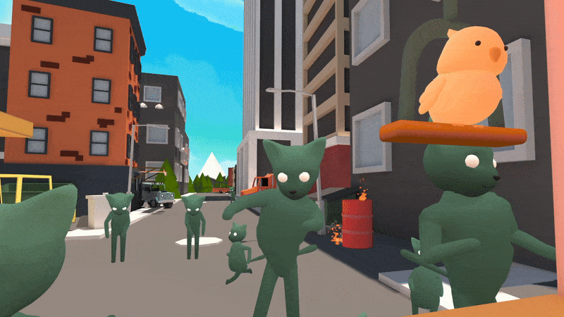
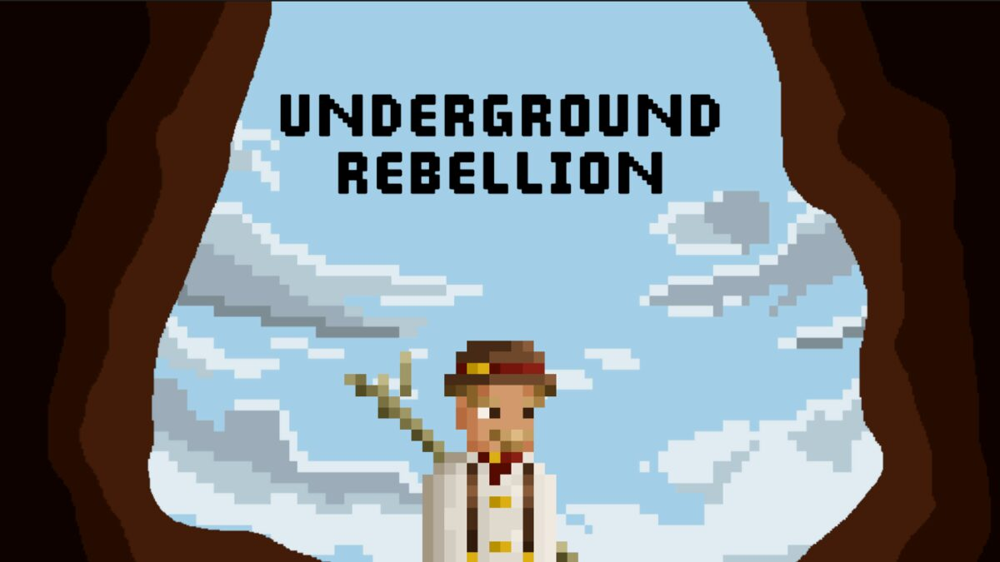
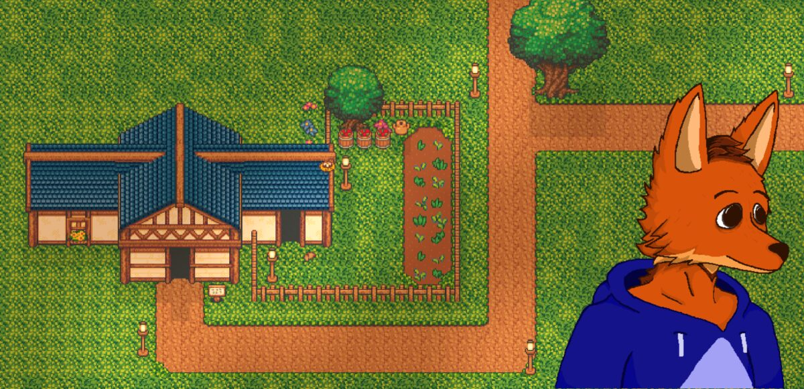
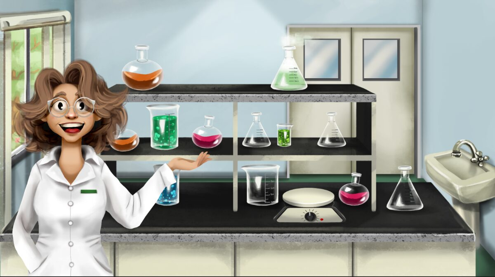
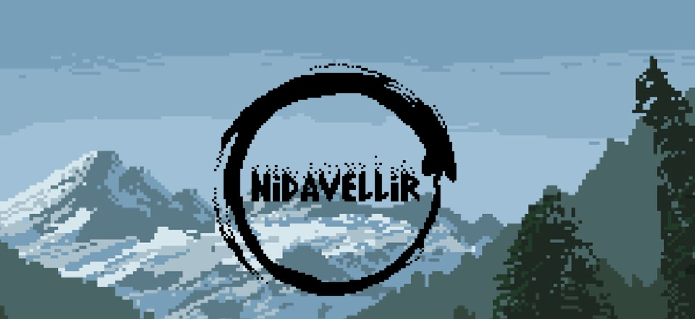

## Currently

  
  

    <h3>Unannounced Title</h3>
    
Studio under NDA · 2026 to date

    
Working as a Game Developer on an unannounced project. More details after launch.

  

## Featured Projects

  <!-- ===== Bake 'Em Up (featured: full width) ===== -->
  <article class="project featured">
    
    

      <h3><a href="https://rafinha-uwu.itch.io/bake-em-up">Bake 'Em Up!</a></h3>
      
VR · Survival / Cooking Sim · Team project

      <ul class="tags">
        <li>Tech Lead</li>
        <li>Cooking System</li>
        <li>Narrative System</li>
      </ul>
      
A VR survival cooking game where you play as a cat baker defending your food truck from zombies, using the breads you bake in real time as weapons. Each bread has its own unique power. As Tech Lead, I also built the cooking simulation system and the narrative system.

      <a class="play" href="https://rafinha-uwu.itch.io/bake-em-up">Play on itch.io →</a>
    

  </article>

  <!-- ===== Underground Rebellion ===== -->
  <article class="project">
    
    

      <h3><a href="https://plbc.itch.io/underground-rebellion">Underground Rebellion</a></h3>
      
PC · 2D Platformer · Team project

      <ul class="tags">
        <li>Tech Lead</li>
        <li>Project Manager</li>
        <li>Enemy AI</li>
      </ul>
      
A 2D platformer where you defeat enemies stealthily or parry their attacks to tire them out. I led the tech side and managed the project, built the enemy AI, narrative and scoring systems, and ran the team's code reviews.

      <a class="play" href="https://plbc.itch.io/underground-rebellion">Play on itch.io →</a>
    

  </article>

  <!-- ===== Porã ===== -->
  <article class="project">
    
    

      <h3><a href="https://swehtam.itch.io/pora">Porã, quem sou eu?</a></h3>
      
Mobile · 2D RPG Adventure · Solo project

      <ul class="tags">
        <li>Design</li>
        <li>Programming</li>
        <li>Dialogue System</li>
      </ul>
      
A 2D mobile RPG I designed and developed solo as my undergraduate thesis. It features branching dialogue that shapes the story, minigames, multiple maps, cutscenes and a day/night lighting system.

      <a class="play" href="https://swehtam.itch.io/pora">Play on itch.io →</a>
    

  </article>

  <!-- ===== Cinética Química ===== -->
  <article class="project">
    
    

      <h3><a href="https://swehtam.itch.io/cinetica-quimica">Cinética Química</a></h3>
      
PC · Serious Game · Solo project

      <ul class="tags">
        <li>Design</li>
        <li>Programming</li>
        <li>Educational</li>
      </ul>
      
A 2D point-and-click serious game about chemistry, made for a friend's undergraduate thesis. Players combine objects found in a lab to learn, then earn points in a pop-up quiz minigame.

      <a class="play" href="https://swehtam.itch.io/cinetica-quimica">Play on itch.io →</a>
    

  </article>

  <!-- ===== Nidavellir ===== -->
  <article class="project">
    
    

      <h3><a href="https://orion-games.itch.io/nidavellir">Nidavellir</a></h3>
      
PC · 2D Top-down RPG · Team project

      <ul class="tags">
        <li>Gameplay Programming</li>
      </ul>
      
A top-down RPG inspired by Norse mythology: escape Niflheim through waves of enemies and a final boss. My first game, made with a team of friends for a university class, where I worked as a gameplay developer.

      <a class="play" href="https://orion-games.itch.io/nidavellir">Play on itch.io →</a>
    

  </article>

## Skills

  

    <h3>Languages</h3>
    <ul class="tags">
      <li>C#</li><li>Python</li><li>GDScript</li><li>JavaScript</li><li>Ruby</li><li>HTML5 &amp; CSS3</li>
    </ul>
  

  

    <h3>Engines &amp; Frameworks</h3>
    <ul class="tags">
      <li>Unity</li><li>Godot</li><li>Inform 7</li><li>Node.js</li><li>Django</li><li>ASP.NET Core</li>
    </ul>
  

  

    <h3>Tools</h3>
    <ul class="tags">
      <li>Git / GitHub / GitLab</li><li>Trello</li><li>Azure</li><li>SQL</li><li>AWS</li><li>Oracle</li>
    </ul>
  

  

    <h3>Fields</h3>
    <ul class="tags">
      <li>Gameplay</li><li>Scripting</li><li>Game Design</li><li>Engine</li><li>Player Experience</li>
    </ul>
  

## About Me

<ul class="education">
  <li>
    <strong>Master's in Digital Game Development</strong>
    University of Aveiro, Portugal · 2026
  </li>
  <li>
    <strong>Bachelor's in Computer Science</strong>
    Federal University of Paraíba, Brazil
  </li>
</ul>

I'm a **game designer and gameplay developer** based in **Aveiro, Portugal**. During my Master's I worked in multidisciplinary teams on a 2D platformer and on my first 3D game, built for VR. Before that, I developed a serious game on my own as my Bachelor's final project.

What I enjoy most about game development is that every project pushes me to learn: new technologies, new ways to solve problems and new people to work with. I love designing and building interactive experiences that can be enjoyed by a wide range of players.

**I'm always open to interesting projects. If that sounds like you, [send me an email](mailto:mathewsalves1@outlook.com)!**

